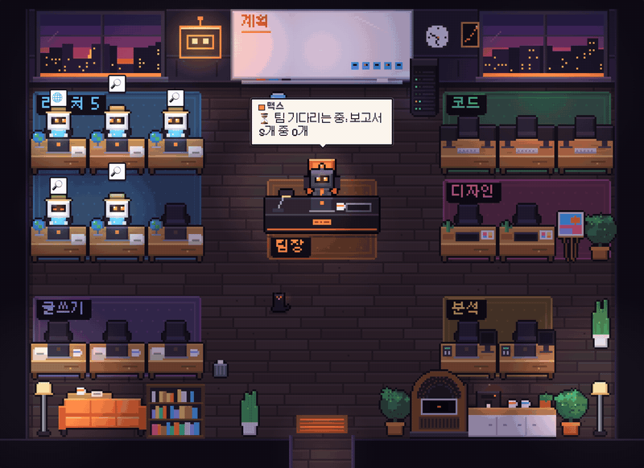
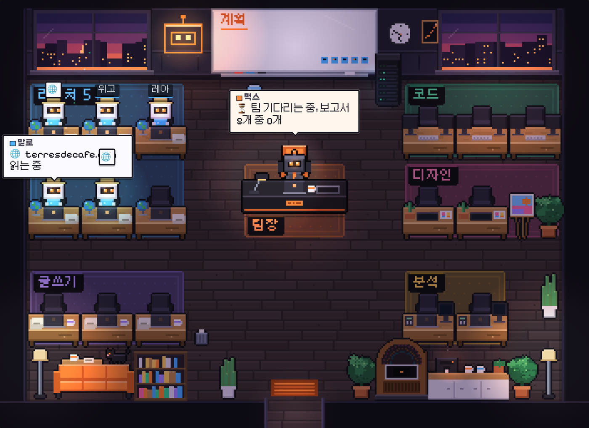
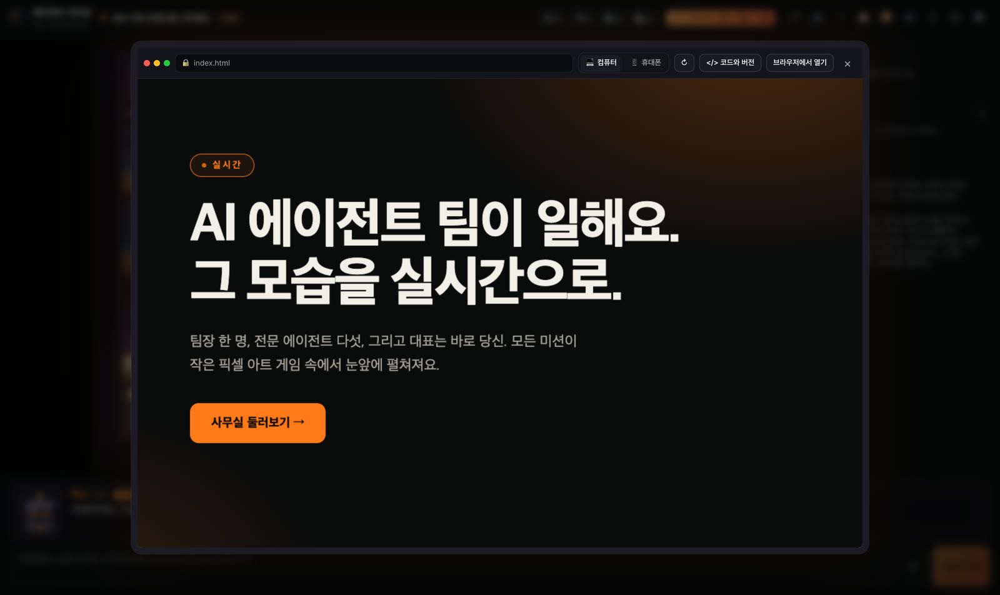

# 에이전트 사무실

**원하는 걸 말해 주세요. AI 에이전트 팀이 눈앞에서 일을 시작해요.**

> 이 저장소는 [VibesMoney](https://vibesmoney.com)의 오픈소스 프로젝트 [Le Bureau des agents](https://github.com/devlikemasta/bureau-des-agents)를 한국어로 옮긴 포크예요. 원 프로젝트와 마찬가지로 MIT 라이선스를 따라요([LICENSE](LICENSE)).

에이전트 사무실은 Claude Code를 픽셀 아트 게임으로 바꿔 줘요. 팀장 맥스가 요청을 읽고 알맞은 전문가를 불러요.
전문가들은 문으로 들어와 자기 자리에 앉고, 머리 위 말풍선에는 지금 이 순간 실제로 하는 일이 나와요.
꾸며 낸 애니메이션이 아니에요. 로봇 하나하나가 진짜 Claude Code 에이전트이고, 내 컴퓨터에서 내 구독으로 일해요.



무료이고, 오픈소스이고, 누구나 고쳐 쓸 수 있게 만들었어요.

---

## 2분 만에 설치하기 (코딩 몰라도 돼요)

1. [Claude Code](https://claude.com/claude-code)가 설치되어 있고 계정에 로그인되어 있어야 해요.
2. Claude Code를 열고 이 문장을 붙여 넣으세요.

   ```
   에이전트 사무실을 설치하고 실행해 줘: https://github.com/Jaemin-m/bureau-des-agents
   ```

3. Claude Code가 사무실을 내려받아 설치하고 실행해요. 브라우저에서 http://localhost:4848 이 열려요.

다음부터는 Claude Code에 "에이전트 사무실 다시 실행해 줘"라고만 하면 돼요.

> **Claude Code에게** (이 링크를 받았다면):
> 1. Node.js 22.18 이상이 설치되어 있는지 확인한다(`node -v`). 없으면 https://nodejs.org 에서 LTS 버전을 설치하자고 제안한다.
> 2. 원하는 폴더(기본: 홈 폴더)에서 `git clone https://github.com/Jaemin-m/bureau-des-agents.git` 한 뒤 `cd bureau-des-agents`, `npm install`.
> 3. `npm start`를 **백그라운드로** 실행한다. 계속 켜져 있어야 하는 작은 서버다. 브라우저에서 http://localhost:4848 이 자동으로 열린다.
> 4. 사무실이 준비됐고, 명령이 실행되는 동안 계속 돌아가며, 이제 맥스에게 첫 미션을 써도 된다고 알려 준다.

### 직접 설치하고 싶다면

```bash
git clone https://github.com/Jaemin-m/bureau-des-agents.git
cd bureau-des-agents
npm install
npm start
```

[Node.js](https://nodejs.org) 22.18 이상이 필요해요. 사무실을 끄려면 터미널에서 `Ctrl + C`를 누르세요.

## 첫 미션

맥스에게 키보드로 쓰거나 말로 하세요(🎙️, 한국어 받아쓰기). 이런 걸 해 볼 수 있어요.

- "원두 커피 브랜드를 시작하려고 해. 경쟁사 5곳을 경쟁사마다 에이전트 하나씩 붙여서 분석하고, 가격을 비교하고, 런칭 사이트를 만들어 줘."
- "이번 주 AI 소식을 정리해 줘. 창업자에게 중요한 새 소식 5가지."
- "내 일에 대한 LinkedIn 글 3개 써 줘."

첫 미션 전에 **"사무실 규칙"**(오른쪽 패널의 버튼)을 채워 주세요. 내가 누구인지, 회사가 무슨 일을 하는지요.
맥스가 미션마다 이걸 먼저 읽어서, 팀이 아무나가 아니라 나를 위해 일해요.

에이전트들은 한국어로 보고하고, 오프라인 데모 미션도 한국어로 옮겨 두었어요.



## 사무실에서 할 수 있는 일

- **뭐든 클릭해 보세요.**
  - 로봇: 맥스가 맡긴 미션, 하나하나의 행동, 보고서가 담긴 카드.
  - 화이트보드: 계획, 누가 무엇을 하는지, 계획의 기록.
  - 프린터: 팀이 만든 파일. 책장: 지난 미션들.
  - 서버: Claude Code, 모델, 내 구독. 시계, 창문(낮, 저녁, 밤)…
- **팀이 만든 사이트를 화면 속에서 보기.** 컴퓨터 화면이나 휴대폰 화면으로, 코드와 모든 버전까지.
- **팀 전체 보기**(👥): 직무, 각자의 Claude Code 도구, 사무실을 거쳐 간 모든 에이전트의 기록.
- **미션 다시 보기**(`H`, 그다음 "다시 재생"): 팀을 다시 부르거나 구독을 쓰지 않고, 똑같이 다시 보여 줘요.
- 주크박스로 **음악 틀기**, 맥스의 **사무실 둘러보기** 듣기(`T`).
- 숨은 재미도 찾아보세요. 고양이 한 마리, 그리고 게이머라면 다 아는 비밀 코드.



### 화면 녹화하기

| 키 | 기능 |
|---|---|
| `F` | 촬영 모드: 카메라가 알아서 움직임을 따라가요. `F`나 `Esc`로 나가요 |
| `V` | 세로 9:16 화면, 인스타그램·틱톡용 |
| `T` | 맥스의 목소리로 사무실 둘러보기 |
| `C` | 자동 카메라 켜기·끄기 |
| `N` | 낮, 저녁, 밤 |
| `J` | 주크박스 |
| `M` | 소리 |
| 마우스 휠 | 원하는 곳 확대(더블클릭: 전체 화면) |

## 내 컴퓨터에서 일어나는 일

- **모든 게 내 컴퓨터 안에 있어요.** 사무실은 내 컴퓨터(127.0.0.1)에서만 연결을 받고, 어떤 웹사이트도 나 대신 팀을 움직일 수 없어요.
- **맥스는 진짜 Claude Code 세션이에요.** 창 없이 미션 폴더(`~/Documents/에이전트 사무실/미션/`) 안에서 실행돼요.
  미션 폴더 이름은 `미션/YYYY-MM-DD HH시 MM분 · 제목` 꼴이에요.
  맥스의 팀은 진짜 Claude Code 서브에이전트이고, 각자 자기 직무의 도구만 가져요.
- **팀은 미션 폴더 밖으로 나가지 않아요**(Claude Code 제한 모드). 내 설정이나 다른 에이전트가 끼어들지 않아요.
- **위험한 행동은 나에게 물어봐요.** 민감한 명령이면 에이전트가 손을 들고, 나는 예 또는 아니요로 답해요.
- **팀이 만든 사이트는 샌드박스 안에서 보여요.** 사무실을 읽을 수도, Claude Code에 말을 걸 수도 없어요.
- **사무실은 가벼워요.** 한 장면 그리는 데 약 1밀리초, 탭이 숨겨져 있으면 아무것도 안 그려요.
- **Claude 구독을 써요.** 내가 Claude Code에 직접 일을 시킨 것과 같아요. 원 프로젝트 테스트에서 에이전트 7명짜리 미션이
  구독의 5시간 사용량 중 2~3%를 썼어요.

macOS에서 테스트했어요. Windows와 Linux에서도 될 거예요. 안 되면 알려 주세요(Issues 탭).

## 맥스의 목소리

원 프로젝트에서는 맥스의 대사를 ElevenLabs로 녹음한 프랑스어 mp3로 들려줬어요. 이 포크에서는 브라우저 음성 합성
(Web Speech API, `ko-KR`)으로 한국어 대사를 읽어요. 브라우저나 운영체제에 한국어 음성이 없으면 소리 없이 자막만 나와요.
원 프로젝트의 프랑스어 mp3는 이 포크에서 지웠어요.

## 함께 고쳐 나가요

에이전트 사무실은 쓰는 사람과 함께 자라도록 만들었어요. 아이디어, 버그, 새 가구, 새 직무, 번역…
처음이어도 괜찮아요. [CONTRIBUTING.md](CONTRIBUTING.md)에 다 설명해 두었어요.

가장 쉬운 방법: 사무실 폴더에서 Claude Code를 열고 추가하고 싶은 걸 말하세요. [CLAUDE.md](CLAUDE.md) 파일이
프로젝트가 어떻게 만들어졌는지 Claude Code에게 알려 줘요.

## 속을 들여다보면

- **`server/`**: 작은 Node 서버예요. `claude -p`(한 줄에 JSON 하나)를 실행하고, `--agents`로 팀을 넘기고, `--restricted`로
  일하며, 도구 호출(`WebSearch`, `WebFetch`, `Write`, `Agent`…) 하나하나를 사무실 안의 행동으로 바꿔요.
- **`src/engine/`**: Canvas 2D로 그린 사무실, 352 × 256 픽셀 이미지예요. 모든 픽셀 아트를 코드로 그리고, 외부 이미지는 없어요.
- **`src/ui/`**: 인터페이스(React). 맥스의 대화창, 여러 창, 팀 패널.

개발하려면 `npm run dev`(http://localhost:5174, 핫 리로드). `npm run check`로 타입을 검사해요.

## 고마운 분들

- **음악**: 사무실을 위해 [ElevenLabs Music](https://elevenlabs.io/music)과 Google Lyria로 만든 원곡.
- **맥스의 목소리**: 원 프로젝트에서는 [ElevenLabs](https://elevenlabs.io) 라이브러리의 "Léo" 목소리(프랑스어 녹음, 이 포크에서는 지웠어요).
  이 포크에서는 브라우저 음성 합성(Web Speech API)을 써요.
- **효과음**: [ZzFX](https://github.com/KilledByAPixel/ZzFX) (MIT).
- **글꼴**: Pixelify Sans(OFL 라이선스, 라틴 픽셀 글자). 한글은 [Galmuri](https://github.com/quiple/galmuri)(픽셀, quiple, SIL OFL 1.1, npm `galmuri`)와
  [Pretendard](https://github.com/orioncactus/pretendard)(본문, SIL OFL 1.1, npm `pretendard`).
- **영감**: [Pixel Agents](https://github.com/pablodelucca/pixel-agents), [claude-office](https://github.com/paulrobello/claude-office)
  (MIT). 에이전트 사무실의 코드와 그림은 새로 작성했어요.

MIT 라이선스([LICENSE](LICENSE) 참고). 원작: [VibesMoney](https://vibesmoney.com)의 프로젝트 — 나를 위해 일하는 AI 에이전트 만드는 법을 알려 줘요.
원 저장소: https://github.com/devlikemasta/bureau-des-agents

---

## In English

This is a **Korean fork** of [Le Bureau des agents](https://github.com/devlikemasta/bureau-des-agents) by VibesMoney (MIT).
It turns Claude Code into a pixel-art game: you give Max, the project lead, a task, and he calls real Claude Code subagents
(research, code, design, writing, analysis), each with only the tools of its trade. In this fork the interface, the agents' replies and
the offline demo are in Korean, and Max speaks through the browser's speech synthesis (`ko-KR`) instead of the original French recordings.

It runs locally with your own Claude Code subscription. Requirements: Node.js 22.18+ and Claude Code.
Manual install: `git clone`, `npm install`, `npm start`, then open http://localhost:4848.
